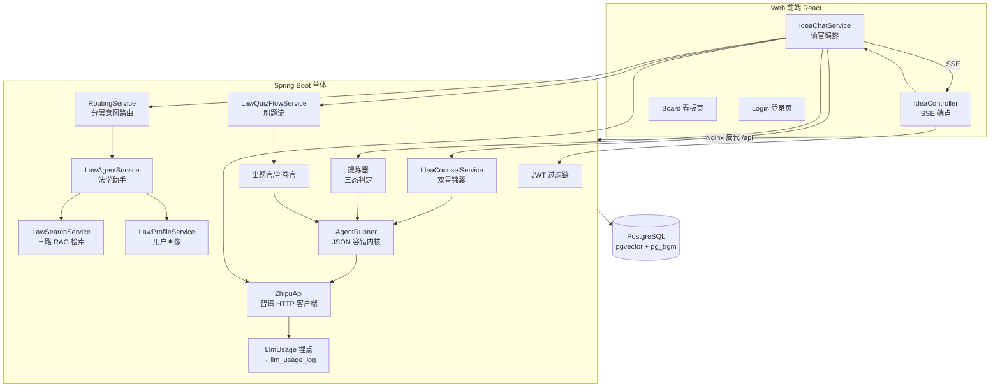
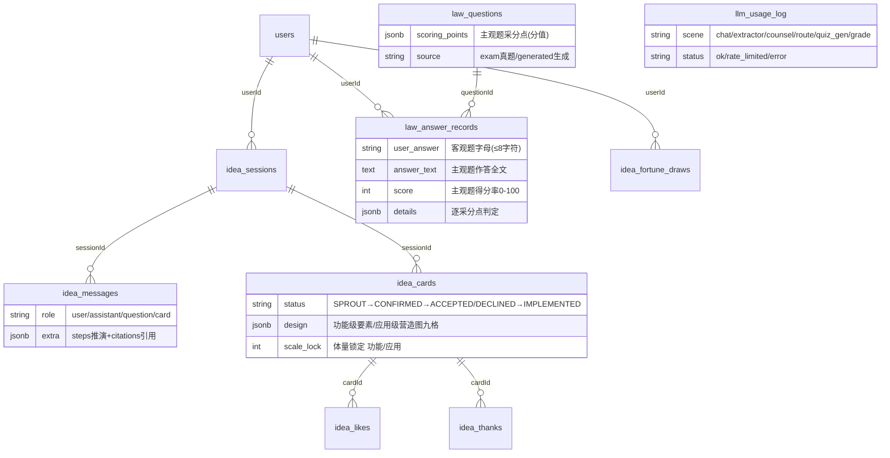

# 点子铺 架构文档

> 定位：仙官「百晓仙君」坐镇的创意收集智能体——朋友聊出来的点子炼成功能卡，好点子被真的做出来；内嵌法学助手（法律咨询 + 法考备考刷题）。
> 形态：单体仓库 = Java 后端 + Web 前端 + 部署脚本（小程序端已放弃保留壳）。
> 更新时间：2026-10（主观题批改上线后）

---

## 1. 系统概览

| 维度 | 说明 |
|---|---|
| 后端 | Java 17 + Spring Boot 3.4，jar 包 + systemd 部署于云服务器 |
| 前端 | React 18 + Vite，白灰简约风，手机/PC 自适应，无路由库（App.jsx state 切视图） |
| 数据库 | PostgreSQL（pgvector + pg_trgm 扩展），JPA ddl-auto 管理 |
| LLM | 智谱 GLM 系列，原生 HTTP 客户端（ZhipuApi），三档模型分工 |
| 部署 | 推送 main 触发 GitHub Actions 构建 → scp → systemd 重启；Nginx 反代 `/api` |
| 观测 | llm_usage_log 埋点 + Prometheus 指标（9913 端口）+ 日志 traceId 全链路 |

---

## 2. 总体架构



---

## 3. 后端架构

### 3.1 包结构

```
com.mengx.server
├── auth        # 登录即注册 + JWT 签发/校验
├── user        # 用户实体（手机号+密码 BCrypt）
├── idea        # 核心业务：仙官编排/刷题流/双星/提炼器/看板/PRD/许愿/感谢卡
├── law         # 法学域：RAG 检索/导入管道/出题官/判卷官/画像/法学助手
├── llm         # ZhipuApi 原生客户端 + 用量埋点三件套
├── routing     # 分层意图路由（注册表驱动）
├── agent       # AgentRunner：所有结构化 agent 的统一内核
├── features    # 每日一签（FortuneDeck 卡池 + 当日幂等抽取）
├── config      # 模型三档/Security/可观测性
└── controller  # 健康检查
```

### 3.2 入口与安全

- **登录即注册**：`POST /api/auth/login` 手机号存在验密码、不存在自动建号（昵称=点友+尾4位）。无独立注册，无访客链路。
- **JWT**：AuthService 签发 → JwtAuthFilter 逐请求校验；SecurityConfig 放行 `/api/auth/login`、`/health`，并显式放行 ASYNC/ERROR 派发类型（否则 SSE 结束误报 Access Denied）。
- **会话归属**：idea 域全部接口 JWT 绑 userId；卡片确认/丢弃校验会话本人；看板全员可见（信任圈产品）。

### 3.3 模型三档（AiModelConfig）

| 档位 | Bean | 模型 | 用途 | 特性 |
|---|---|---|---|---|
| 流式档 | streamingChatModel | glm-4.7 | 仙官/法学助手前台 | thinking 强制关闭（省 30s+ 首延迟） |
| 同步档 | chatModel | glm-4.7 | 双星/提炼器/出题官/判卷官等结构化 agent | JSON 输出，AgentRunner 统一容错 |
| 路由档 | routeChatModel | glm-4-flash | L2 灰区意图细判 | 低延迟二分类 |

三档全部经 ZhipuApi 原生 HTTP 客户端调用（langchain4j 不支持 thinking 字段注入），内置 1302 限流 2 秒退避重试。

### 3.4 多 Agent 体系（仙班）

用户视角只有一个仙官；其余 agent 全部隐身幕后。

| Agent | 模型档 | 触发时机 | 职责 |
|---|---|---|---|
| **仙官百晓仙君**（IdeaChatService） | 流式 | 前台唯一出口 | 闲聊/答疑/访谈点子/转述锦囊；宣布炼卡话术触发落卡 |
| **产品星君**（议程官） | 同步 | 提炼器判 WISH 后预取 | 每轮输出单维度推进议程+缺项+风险 |
| **工造星君**（设计稿执笔人） | 同步 | 同上（与产品星君串行） | 每轮输出营造图九格快照，逐轮累积演进；体量锁定防摇摆 |
| **提炼器** | 同步 | 仙官每轮回答后 | 三态判定：WISH（开设计模式）/ NO_CARD / JSON（炼卡）；炼卡触发与仙官宣布话术强绑定 |
| **法学助手**（LawAgentService） | 流式 | 路由到法学域 | RAG 问答；消息严格交替+空消息过滤（防 API 1214） |
| **出题官**（LawQuestionGenService） | 同步 | 刷题意图 | 客观题逐题生成（题型轮换+考点防重复）+ 主观题生成（采分点结构） |
| **判卷官**（LawSubjectiveJudgeService） | 同步 | 主观题交卷 | 逐采分点 hit/partial/miss 判定，得分率≥60 及格落库 |
| **PRD 格式化官**（IdeaPrdService） | 同步 | 卡片详情导出 | 功能卡→施工 PRD，应用卡→蓝图文档，Markdown 写回 prdJson |
| **许愿池精灵**（IdeaWishService） | 同步 | 一句话愿望 | 提炼官初稿→追问官打磨→入库+自动开会话 |

**AgentRunner** 是全部幕后 agent 的统一内核：人设注入、模型调用、markdown 围栏剥离、JSON 解析失败自动重试。新增 agent 只需实现 prompt + record。

### 3.5 分层意图路由（RoutingService + ChannelRegistry）

消息先判域（默认通道 vs 法学通道），注册表驱动，新增能力零路由代码改动：

```
L0.5 强意图直达：命中本通道 strongSignals（如「继续出」「案例分析」）→ 零模型直达
L1   信号词层  ：默认通道零信号→留默认；专项通道命中信号→续通道
L2   灰区细判  ：仅灰区消息调用 glm-4-flash（携带最近 6 轮背景+通道名册）
L3   兜底粘性  ：解析失败/超时→粘住上一通道
```

通道粘性：上一轮会话通道作为 L2 输入，避免追问被误路由。

### 3.6 核心链路

**SSE 聊天主链路**（IdeaController `/api/idea/chat/stream`，SseEmitter 手动桥接 + boundedElastic 后台线程，逐 token flush）：

```
用户消息 → 路由判域 → [法学域] 刷题流拦截？→ 法学助手 RAG 问答
                  → [默认域] 仙官流式作答（锦囊预取读档注入）
        → 回答收口 → 提炼器三态判定
            WISH  → 异步预取双星锦囊（下轮直读，消除等待）
            JSON  → 落库功能卡 → SSE card 事件下发前端
```

**刷题流**（LawQuizFlowService，法学域内拦截）：

```
出题意图 → 客观组：逐题生成逐题下发（首题~15s，单选→多选→不定项轮换）
        → 主观组：独立成组一次一道（案例分析+采分点，采分点不下发防泄题）
试卷模式：前端本地暂存点选/作答 → 交卷按钮
        → 客观：纯代码字母比对判分（零模型）→ 汇总讲评
        → 主观：判卷官 LLM 逐采分点批改 → 讲评（得分/✓△✗/总评/参考答案）
「继续出」按钮内嵌讲评气泡，强意图直达法学通道
```

**炼卡防线**：仙官本场已炼卡记忆 + 提炼器仅识别最新发言新愿望 + 落库前标题归一化语义比对，三层防重复；单场上限 5 卡。

### 3.7 法学 RAG

- **三路融合检索**（LawSearchService）：编号正则精确匹配置顶 → 向量召回（1024 维 qwen3.7-text-embedding-flash）→ pg_trgm word_similarity 字面补充；RRF 融合，任一路失败自动降级。
- **真题路**：命中备考意图信号词（真题/刷题/考点/押题…）才触发，日常咨询只查法条；年份感知指代解析（法名继承）。
- **数据管道**（LawImportService，CommandLineRunner + profile）：三类表 law_articles（法条+司法解释）/ law_questions（2002-2024 真题）/ law_notes（教材，待接入），content_hash 幂等锚点；16 条/批限速向量化。
- **用户画像**（LawProfileService）：不建表，law_answer_records 实时聚合；弱点=题量≥2 且错误率≥50%；三消费点：出题加权（quizBriefing）/问答口吻（chatHint）/学情汇报（report）。

---

## 4. 数据模型



---

## 5. 前端架构

- **视图**：App.jsx state 切换 Login → Chat（主界面）/ Board（看板），无路由库。
- **顶栏**（Chat）：百晓通品牌菜单（看板/每日一签折叠）+ 聊天记录图标 + 新开一场加号 + 退出。
- **SSE 消费**：streamIdeaChat（fetch + ReadableStream），事件类型 thinking/chunk/card/question/design/done/error；thinking 推演面板逐条淡入，正文开始自动收起。
- **试卷模式**：题卡逐张到达即可作答（客观点选 toggle 暂存/主观 textarea），全组答完交卷按钮点亮，批量提交判分；「继续出」仅嵌在当前会话最后一条讲评内。
- **营造图面板**：design 事件实时下发九格 AgentSpec，待聊格子置灰、新更新带标记；历史场次恢复。
- **登录态**：手机号+密码自动回填 localStorage。
- **会话恢复**：消息从后端拉取（换设备不丢），localStorage 只存当前场指针。
- **PC 适配**：消息列 820px 居中窄栏，输入框封顶 726px；移动端输入 16px 防 iOS 聚焦缩放。

---

## 6. 可观测性

| 层 | 实现 |
|---|---|
| 用量埋点 | LlmUsage（ThreadLocal scene）→ ZhipuApi 单点上报 → LlmUsageRecorder 双写：llm_usage_log 表 + Micrometer；scene 覆盖 chat/extractor/counsel/route/quiz_gen/grade，流式按字符估算 token |
| Metrics | actuator + prometheus registry，管理端口 9913 仅绑 127.0.0.1；业务指标 llm_calls_total/llm_latency_seconds/llm_tokens_total + rag/embedding 指标 |
| Tracing | traceId/spanId 随每行日志输出，Reactor 上下文自动传播（SSE 切后台线程不丢）；grep 一个 traceId 串起路由→检索→炼卡全链路 |
| 查账 | `SELECT scene,sum(completion_tokens) FROM llm_usage_log WHERE created_at>now()-interval '7 days' GROUP BY scene` |

---

## 7. 部署架构

```
GitHub push main ──► Actions: mvn package + npm build ──► scp ──► systemd 重启
浏览器 ──► Nginx(80/443) ──/api 反代──► Spring Boot(8080) ──► PostgreSQL(pgvector)
                                    └─ / 静态托管 ──► web/dist
SSE 关键配置：proxy_buffering off + X-Accel-Buffering: no（禁用缓冲防整段输出）
```

- 敏感配置（数据库密码/LLM 密钥/embedding 密钥）全部环境变量注入，`application-local.yml` 不入库。
- 服务器侧按 `deploy/` 目录脚本初始化（nginx.conf / meng-x.service / server-setup.sh）。

---

## 8. 关键设计决策（速查）

1. **SSE 不走 ResponseEntity 包 Flux**：泛型通配使 converter 识别失败；直接返回 SseEmitter 手动订阅逐 token send。
2. **thinking 强制关闭**：glm-4.7 思考型模型不关首延迟 30s+；langchain4j 不支持自定义字段，故有 ZhipuApi。
3. **炼卡触发与宣布话术强绑定**：仙官话术含「功能卡+整理/炼成」即触发，避免宣布了但卡没生成的不一致。
4. **锦囊预取**：上轮 WISH 后异步拉双星锦囊缓存，下轮直读消除等待；双星串行执行压并发防 1302。
5. **交卷按题号精确匹配**：列表下标会因单题生成失败错位，判分空转。
6. **主观题独立成组**：作答时长/判分方式与客观题差异大；采分点不下发前端防泄题；得分率≥60 对齐法考及格线，画像零改动兼容。
7. **pg_trgm 用 word_similarity**：短查询对长条文相似度差，统计查询术语覆盖率才有效。
8. **意图路由分层而非扁平多分类**：确定性优先（L0.5/L1 零模型），灰区才动模型；注册表驱动，新通道上线零路由代码。
